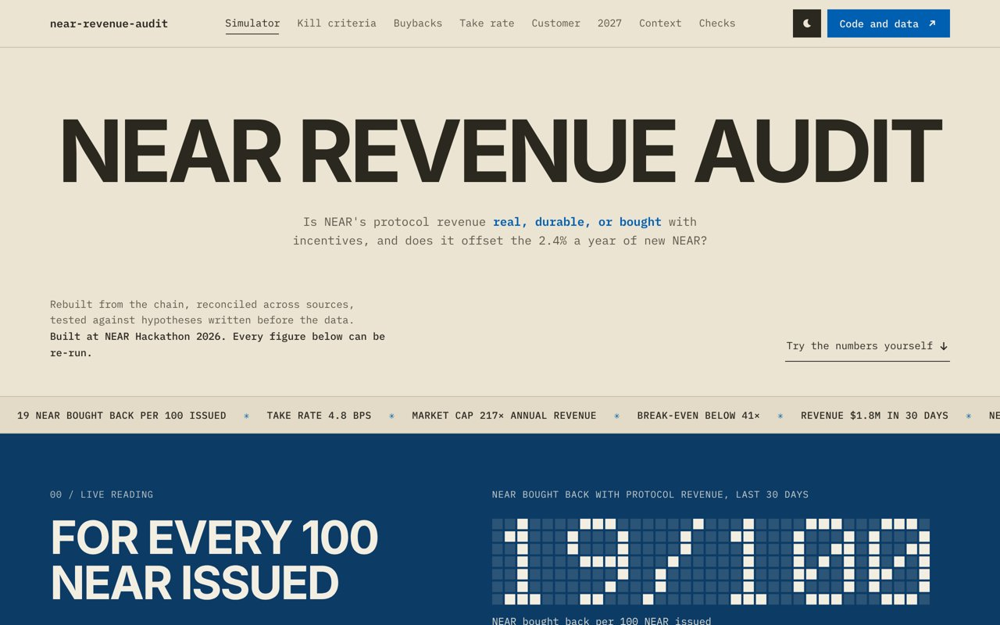
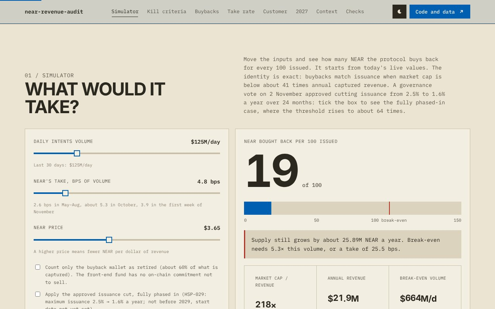
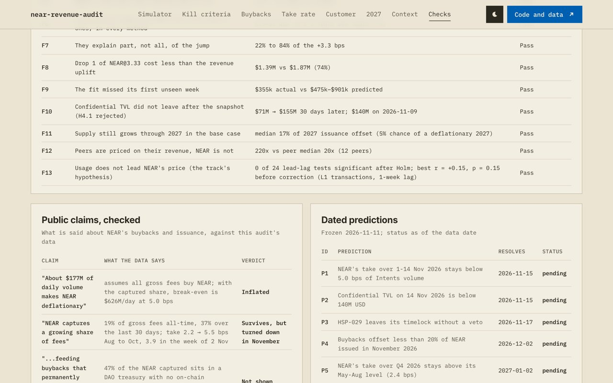

<!-- Generated from docs/templates/README.md by `make docs`; edit the template, not this file. -->
# NEAR Revenue Audit

[](https://github.com/Wilivms/near-revenue-audit/actions/workflows/tests.yml)

*Investment Thesis track (`thesis`), NEAR HACKATHON 2026. Data to 2026-11-12.*

**[Live dashboard](https://near-revenue-audit.vercel.app)** · **[One-page thesis](THESIS.md)** · **[Full report](REPORT.md)** · **[Headline numbers, exactly](#the-headline-numbers-exactly)** · **[Where we were wrong](#where-we-were-wrong-and-what-changed)** · rebuild everything: `make setup && . .venv/bin/activate && make check-clean`

NEAR Intents now earns protocol revenue, and since 2026-02-23 that revenue buys NEAR. Several public dashboards, NEAR's own included, now report how much. This project asks the questions they do not answer: **why** the revenue moved, **who** pays it, **what** the growth cost, whether it **lasts**, and what that means for the token. Every number below is computed from public data by code in this repository, and every document is rendered from those outputs.

**In one sentence:** NEAR's protocol revenue is real (rebuilt from the chain and matched by three independent sources) but too small to support the token through buybacks (14.8% of new NEAR offset; market cap 205x captured revenue against 41x for break-even), its recent doubling was partly bought with an airdrop, and NEAR does not own the customers who pay it.

## The headline numbers, exactly

Each number with its window, its source and the command that rebuilds it. None of these commands needs a key or the network, and `make verify` prints all four.

| Number | What it is, exactly | Rebuild it |
| --- | --- | --- |
| **14.8%** of new NEAR offset | NEAR received by NEAR's three revenue wallets ÷ NEAR issued, February 2026 to October 2026 (whole months since the 2026-02-23 fee switch). NEAR's own dashboard gives 16.3% | `make supply official` |
| **205x** market cap ÷ captured revenue | Market cap on 2026-11-13 ($4.6B, CoinGecko) ÷ revenue the wallets received from 2026-10-14 to 2026-11-12, annualised ×365/30 ($22.6M a year). Not the 208x on DefiLlama's holders revenue, which is used only to compare with peers on one definition | `make revenue comps` |
| **41x** break-even multiple | Supply stops growing when buybacks equal issuance (2.43% of supply a year), so when market cap ÷ captured revenue falls to 1 ÷ 2.43%. At today's take that is about $639M of daily volume | `make supply montecarlo` |
| **92%** of the 1Click fee pool kept by integrators | 1Click swaps from 2026-10-14 to 2026-11-12 (partner API); fee pool = integrators' app fees + NEAR's protocol fee | `make oneclick-offline` recomputes it from the committed daily aggregates |

## Start here

| Time | Do | You see |
| --- | --- | --- |
| 2 min | Open the **[live dashboard](https://near-revenue-audit.vercel.app)** | the live reading (NEAR bought back per 100 issued, recomputed in your browser), then the simulator: move volume and take rate, see break-even |
| 5 min | Read **[`THESIS.md`](THESIS.md)** | the claim, evidence for and against, what would change our mind, what could not be computed, on one page |
| 2 min | Run `make setup && . .venv/bin/activate && make check-clean` | every output rebuilt from committed data and compared: `39/39 outputs match`, `15/15 findings hold` |
| 3 min | Open **[REPORT section 9](REPORT.md#9-public-claims-checked)** | 33 public claims about NEAR tested at their own dates |
| as needed | **[`REPORT.md`](REPORT.md)** (the full argument), **[`FAQ.md`](FAQ.md)** (reviewer questions), **[`RESEARCH_LOG.md`](RESEARCH_LOG.md)** (48 dated entries, dead ends and corrections), **[`HYPOTHESES.md`](HYPOTHESES.md)** (written before the tests), **[`predictions/`](predictions/)** | |

## Why this thesis is different

**Findings this thesis adds**
- **The doubling was partly bought.** NEAR's take went from 2.2 to 5.5 bps between August and October; confidential swaps under the NEAR@3.33 airdrop explain 22%–84% of the rise, and the first drop cost 74% of the revenue it added.
- **NEAR does not own the customer.** On 512k 1Click swaps from the partner API, integrators keep 92% of the fee pool; the 20 bps that NEAR's published fee schedule sets for integrator swaps is paid on a small part of their volume. November's drop came from one integrator's burst ending, while NEAR's own front-end revenue held.
- **NEAR's own revenue series runs 21% above what its three revenue wallets receive**, every month, while the wallet totals agree within 0.16%.
- **It is already easing, and the model said so by failing.** The weekly fit missed its first unseen week ($355k against $475k–$901k predicted). In early November the take fell to 3.9 bps on three sources while confidential TVL fell 26% from its peak.
- **The two questions NEAR did not answer, narrowed to testable hypotheses:** confidential swaps pay about 7.6 bps into the buyback multisig (matching NEAR's Dune fee table), and most of the 21% gap is quote-improvement revenue that never reaches the wallets that buy NEAR (without it: 4.5% this year). [REPORT section 10](REPORT.md#10-the-two-questions-near-did-not-answer-and-what-the-data-says).
- **Transaction counts mislead.** Over two 12-day windows (20–31 October, 1–12 November), transactions to `intents.near` changed +85% while NEAR's captured revenue changed -18%. NEAR's BigQuery dataset shows why: 99.9% of the increase is `intents.near` signing its own transactions; transactions from everyone else changed +9%. A dashboard that counts transactions reads November as a boom. (`make bigquery`)
- **Valuation:** valued like peers whose holders receive revenue, this revenue supports about $0.33 a NEAR, against $3.42 (daily close, 2026-11-13).

**Every number checked against independent sources**
- Revenue rebuilt from the chain matches DefiLlama within 0.8% and NEAR's own dashboard within 0.16%; NEAR's public BigQuery dataset matches the wallet histories **to the last digit** (3.292M NEAR) and issuance within 0.06%.

**Held to account in public**
- 15/15 findings with explicit pass conditions, re-checked in CI on every commit; documents rendered from the outputs, so no figure is typed by hand.
- 33 claims by NEAR, Nansen, analysts and the press tested at their own dates: 18 survive, 6 are close, 9 do not hold.
- Hypotheses and kill criteria written before the analysis; the weekly model missed its first unseen week and the report says so.
- Six dated predictions, frozen on 2026-11-11, timestamped in Bitcoin and anchored on NEAR (testnet); two resolve before judging (P1 so far: 4.1 bps, 11-01 to 11-12, threshold 5.0).

**Reproducible by anyone**
- Offline from committed snapshots, one command, no key: `make check-clean`. Works with any Python (`make setup` fetches 3.12 if needed) and on a ZIP download.
- The 1Click results, which come from a partner API, are recomputed from published daily aggregates without the key (`make oneclick-offline`, finding F15); see [1Click data](#1click-data-what-you-can-check-without-a-key).

[](https://near-revenue-audit.vercel.app)

## Where we were wrong, and what changed

Kept in the open because a thesis is only as good as its corrections. Each one is dated in [`RESEARCH_LOG.md`](RESEARCH_LOG.md).

| What we said | What the data then showed | What changed | Log |
| --- | --- | --- | --- |
| A weekly fit explains NEAR's revenue from public and confidential volume | It missed its first unseen week: $355k actual against $475k–$901k predicted | The airdrop is now "the largest identified driver" of the jump, 22%–84% of it, not "most of it" | 30, 32 |
| Confidential swaps pay NEAR about 11 bps | The 11 bps came from a trend in the front-end fund; fitted wallet by wallet, the buyback multisig gets 7.6 bps | Matches NEAR's own Dune fee table (7.4 bps) | 42 |
| The airdrop's cost cancels the revenue it added | Drop 1 cost 74% of the uplift, not all of it | Reported as a net gain, small against supply | 32 |
| The Monte Carlo engine sizes 2027 | In a walk-forward test it was too optimistic for 2026 | The 2027 figures are flagged as more likely too high than too low | 21 |
| The 92% integrator share covered 2.6M swaps | 2.6M was every swap collected at the time (2.7M now); the 30-day window holds 512k | Both counts published separately; the 92% itself was right | 36 |

## Findings, each one a check

`make verify` rebuilds every document from the outputs and re-runs these checks; it fails if a finding no longer follows from the data or a document has drifted from it. Result on the committed data: **15/15 hold**.

| ID | Finding | Number | How it is checked | Result |
| --- | --- | --- | --- | --- |
| F1 | Reported revenue reaches NEAR's wallets | $8.09M rebuilt vs $8.15M on DefiLlama (ratio 0.992) | NEAR inflows to the 3 revenue wallets (NearBlocks) at daily prices vs DefiLlama holders revenue, since the fee switch; holds if within ±2% (`make revenue`) | PASS |
| F2 | NEAR's own dashboard agrees on the wallets | 4.346M vs 4.339M NEAR (0.16% apart) | all-time NEAR received by the same 3 wallets vs revenue.near.org's wallet table; holds if within ±1% (`make official`) | PASS |
| F3 | Buybacks offset well under a fifth of issuance | 14.8% (NEAR's dashboard: 16.3%) | NEAR captured / net issuance from archival-RPC total supply, Feb–Oct 2026; holds if both definitions are below 20% (`make supply official`) | PASS |
| F4 | Market cap is far above break-even | 205x annual captured revenue vs 41x (64x after HSP-029) | identity: supply stops growing iff market cap / annual captured revenue < 1 / issuance; holds if above the post-cut threshold (`make montecarlo`) | PASS |
| F5 | NEAR's take more than doubled Aug to Oct | 2.2 → 5.5 bps of volume | wallet revenue / NEAR-reported Intents volume, by month; holds if October ≥ 2× August (`make official`) | PASS |
| F6 | Confidential swaps pay NEAR more than public ones, in every method | 5.5–11 bps vs 1–3 (Dune fee table 7.4) | weekly fit in levels and in first differences, Aug–Oct; holds if the confidential coefficient exceeds the public one in both (`make confidential`) | PASS |
| F7 | They explain part, not all, of the jump | 22% to 84% of the +3.3 bps | (change in confidential share) × (confidential premium) / rise in take, under three premiums; holds if the range spans below 100% (`make confidential`) | PASS |
| F8 | Drop 1 of NEAR@3.33 cost less than the revenue uplift | $1.39M vs $1.87M (74%) | 333,333 NEAR at the conversion price vs Sep–Oct revenue above the May–Aug take rate; holds if cost < uplift (`make confidential`) | PASS |
| F9 | The fit missed its first unseen week | $355k actual vs $475k–$901k predicted | week of 2026-11-02, never used in the fit; holds (as a reported failure) if actual < both predictions (`make confidential`) | PASS |
| F10 | Confidential TVL did not leave after the snapshot (H4.1 rejected) | $71M → $155M 30 days later; $138M on 2026-11-12 | Dune confidential TVL around the NEAR@3.33 snapshot, then NEAR's dashboard; holds if TVL 30 days later > at the snapshot (`make confidential official`) | PASS |
| F11 | Supply still grows through 2027 in the base case | median 18% of 2027 issuance offset (7% chance of a deflationary 2027) | Monte Carlo, 10,000 paths, joint block bootstrap of volume and price; holds if the median is below 100% with and without HSP-029 (`make montecarlo`) | PASS |
| F12 | Peers are priced on their revenue, NEAR is not | 208x vs peer median 20x (12 peers) | market cap / annualised holders revenue (DefiLlama, CoinGecko); holds if NEAR is above every peer's interquartile range (`make comps`) | PASS |
| F13 | Usage does not lead NEAR's price (the track's hypothesis) | 0 of 24 lead-lag tests significant after Holm; best r = +0.15, p = 0.15 before correction (L1 transactions, 1-week lag) | weekly changes, NEAR price net of BTC, lags 1–4 weeks, Intents volume and L1 activity, both directions; holds if none is significant at 5% after Holm (`make leadlag`) | PASS |
| F14 | NEAR's BigQuery dataset agrees with the pipeline's sources | revenue wallets 3.292M NEAR on both, max monthly gap none; net issuance Feb–Oct 23.87M (0.06% apart) | queries in sql/ run on NEAR's public BigQuery dataset vs NearBlocks wallet histories and archival-RPC supply; holds if every month is within 0.1% and issuance within 0.5% (`make bigquery`) | PASS |
| F15 | The 1Click results recompute without the partner key | 30 figures (integrator shares, the November take, the fee-schedule test) recomputed from the published daily aggregates, all within 1.5% | data/processed/oneclick_daily.csv (daily sums by integrator, route type, NEAR fee tier, ZEC; no swap or address) recomputed and compared with the outputs of make swaps; holds if all agree within 1.5% (`make oneclick-offline`) | PASS |

## Try it (do X → see Y)

| What would it take? (simulator) | Every finding as a live check |
|---|---|
| [](https://near-revenue-audit.vercel.app/#simulator) | [](https://near-revenue-audit.vercel.app/#checks) |

Everything below runs offline on the committed snapshots in `data/raw/` (listed with their sha256 in `data/raw/MANIFEST.json`). Needs Python 3.12 or later (pandas 3, numpy 2.5; `make setup` gets it if yours is older) and `make`; no key, no account, no network. `make check-clean` takes about a minute; it also works on a ZIP download without git.

```bash
git clone https://github.com/Wilivms/near-revenue-audit && cd near-revenue-audit
make setup && . .venv/bin/activate   # Python 3.12+ and four pinned packages; fetches Python 3.12 with uv if yours is older
make check-clean      # rebuilds everything, runs the tests, then compares every output with the committed one
make verify           # renders README/REPORT/FAQ/THESIS from the outputs and re-checks the findings
```

| Command | You should see |
| --- | --- |
| `make check-clean` | the tests pass, then `39/39 outputs match the committed ones` (text exactly, numbers to 1e-9) |
| `make verify` | `15/15 findings hold` and no stale document |
| `make revenue` | revenue rebuilt from the 3 revenue wallets vs DefiLlama: $8,087,549 vs $8,149,355 since the fee switch |
| `make official` | the same wallets against NEAR's own dashboard (0.16% apart), the take rate on both revenue definitions, capture by mechanism |
| `make confidential` | the weekly fit (1.0 bps public, 11.0 confidential; 5.5 on week-to-week changes), the share of the jump explained, the airdrop counterfactual, the out-of-sample week, H4.1 |
| `make supply` | Feb–Oct 2026: 23.9M NEAR issued, 3.53M captured (14.8%) |
| `make montecarlo` | 11 scenarios to end-2027; base case 18% of 2027 issuance offset; break-even at $639M/day of volume at 4.9 bps |
| `make governance` | HSP-029 read from `vote.dao`: 99.97% of veNEAR cast in favour, timelock ends 2026-11-16 |
| `make leadlag` | 24 lead-lag tests of usage against price, 0 significant after Holm |
| `make bigquery` | NEAR's BigQuery dataset against the pipeline's sources: revenue wallets 3.292M NEAR on both, issuance within 0.06%, daily activity identical on 408 days |
| `make anchor-check` | the hashes anchored on NEAR testnet read back with a view call and matched to the files: predictions, raw-snapshot manifest, daily bundle (`anchors: OK`; needs network) |
| `make oneclick-offline` | the 1Click figures (integrator shares, the November take, the fee-schedule test) recomputed from `data/processed/oneclick_daily.csv`, the published daily aggregates, without the partner key: `all agree` (finding F15) |
| `make swaps` | without a partner key: a message that the per-swap 1Click data is private and not committed; its aggregates in `data/processed/` are what the documents read. With `INTENTS_JWT` in `.env`: `python3 -m src.ingest.intents_explorer`, then `make swaps` |
| `make predictions` | six frozen predictions, resolved as their dates pass |
| `make dashboard-serve` | the dashboard at http://localhost:8000 |

With network access, `make refresh` fetches fresh snapshots and re-runs everything. A daily GitHub Action does this and commits `dashboard/live.json`, which the hosted dashboard loads first; `dashboard/data.json` stays the reproducible one.

## 1Click data: what you can check without a key

The 1Click results come from the NEAR Intents Explorer API, which needs a partner key. Its terms do not allow archiving or redistributing the swaps, so they are not in the repository.

| | Without a key | With a free partner key |
| --- | --- | --- |
| Integrators' share of the fee pool (92%), each integrator's share of app fees and of NEAR's revenue | ✅ `make oneclick-offline` recomputes them from `data/processed/oneclick_daily.csv` (daily sums by integrator, route type, NEAR fee tier, ZEC; no swap or address) | rebuilt from the swaps |
| November: NEAR's 1Click take with and without Trust Wallet, revenue without an integrator, ZEC | ✅ same | rebuilt from the swaps |
| NEAR's fee schedule against what integrators pay | ✅ same | rebuilt from the swaps |
| Sender concentration and round trips (2.9% of volume), retention across sample weeks | committed results only (`oneclick_quality.json`, `retention.csv`) | ✅ rebuilt from the swaps |

**Getting a key:** sign in at [partners.near-intents.org](https://partners.near-intents.org/home) and copy the JWT from the Partner Dashboard (the 1Click docs: [authentication](https://docs.near-intents.org/integration/distribution-channels/1click-api/authentication)). Put it in `.env` as `INTENTS_JWT=...`, then `python3 -m src.ingest.intents_explorer --since 2026-10-11T00:00:00Z --until 2026-11-11T00:00:00Z` (about 45 minutes: the API allows one request every 5 seconds) and `make swaps`.

## Judging map

| Criterion | Where to check it |
| --- | --- |
| Runs as described | `make check-clean` (CI runs it on every push: badge above); `make verify`; `data/raw/MANIFEST.json` with a test that every snapshot matches its hash |
| Evidence, not conviction | 15 findings with explicit pass conditions (above); hypotheses and kill criteria registered before the analysis ([`HYPOTHESES.md`](HYPOTHESES.md), unchanged since its first commit); results against expectations reported as written (H4.1 rejected, the fit's out-of-sample miss, a kill criterion triggered on 1Click) |
| Technical implementation | revenue rebuilt from wallet histories ([`revenue_wallets.py`](src/analysis/revenue_wallets.py)); supply from archival-RPC headers ([`supply.py`](src/analysis/supply.py)); 2.7M swaps from the Intents Explorer API ([`intents_explorer.py`](src/ingest/intents_explorer.py), [`swaps.py`](src/analysis/swaps.py)); robustness of the channel fit ([`confidential.py`](src/analysis/confidential.py)); joint block bootstrap with a walk-forward backtest ([`montecarlo.py`](src/analysis/montecarlo.py), [`backtest_mc.py`](src/analysis/backtest_mc.py)); governance read on-chain ([`governance.py`](src/analysis/governance.py)) |
| Design | the dashboard: a what-if simulator on the break-even identity, live kill criteria, a scenario fan chart, a "show the numbers" table under each chart and the sources listed on the page; light theme, phone widths, reduced-motion support |
| Impact | findings that change how NEAR's revenue should be read: the September jump decomposed and costed, the integrator economics of 1Click, a 21% gap inside NEAR's own revenue reporting, a public threshold ($177M/day) shown to be 3–6× too low |
| Originality | swap-level data no other thesis uses; an incentive's cost set against the revenue it bought; a model whose own failure is published; NEAR's dashboard audited against the chain |
| Sustainability | `make refresh` and a daily Action; predictions that resolve from 2026-11-15 to 2027-04-02 with a resolver; MIT licence |

## Predictions

Six predictions were frozen on 2026-11-11 in [`predictions/PREDICTIONS.csv`](predictions/PREDICTIONS.csv): sha256 committed next to it (checked by a test) and timestamped in Bitcoin with OpenTimestamps, confirmed in block 975,397 (`ots verify predictions/PREDICTIONS.csv.ots`), and anchored on NEAR: the same sha256 is stored in SocialDB on testnet under `near-revenue-audit.testnet/audit/predictions` (transaction [AWcwWsaf…](https://testnet.nearblocks.io/txns/AWcwWsafGXGUw9zh1rZsSwirScbaWDvo2Vct6ESWBB8t)). The raw-snapshot manifest ([HZMwjHcZ…](https://testnet.nearblocks.io/txns/HZMwjHcZ7vSgzHJBBr74X5m3t53ZgHr5KMH2ZXk8Mw9J)) and the dashboard bundle ([ASxmSMNY…](https://testnet.nearblocks.io/txns/ASxmSMNYuZxciwdyFkFAT3KoCvbJhvg3cJB3PzDCtst9)) are anchored the same way at each release (`node anchor/anchor.mjs`); the daily refresh also anchors its bundle when the `NEAR_TESTNET_KEY` repository secret is set. `make anchor-check` reads them back with a view call, no key needed. Two resolve before judging starts (P1, P2 on 2026-11-15), one on its second day (P3), the rest by April 2027. `make predictions` resolves those whose date has passed; results go to [`predictions/RESULTS.md`](predictions/RESULTS.md).

Reading so far, on data to 2026-11-12 (not a resolution): **P1** 4.1 bps, 11-01 to 11-12 against a threshold of 5.0; **P2** 137.9M USD on 2026-11-12 against 140M; **P3** Timelock. The daily refresh updates these on the dashboard's Checks section.

## What NEAR's own dashboard shows, and what this adds

NEAR published [revenue.near.org](https://revenue.near.org/) in November 2026, after this rebuild. It shows **how much**; this audit asks what it is worth.

| Question | revenue.near.org | This audit |
| --- | --- | --- |
| How much revenue, how many NEAR bought? | Yes | Rebuilt independently from the chain; wallets agree within 0.16%; its revenue series runs 21% above them |
| Who pays it? | No | Per integrator and per asset on 2.7M 1Click swaps, to 2026-11-12 |
| What did the growth cost? | No | Drop 1 of NEAR@3.33 cost 74% of the revenue uplift; net 146k NEAR removed |
| Will it last? | No | Pre-registered kill criteria, a fit that failed out of sample, dated predictions |
| What does it mean for the token? | Offset to date | The break-even identity (41x, 64x after HSP-029, vs 205x today), a 2027 Monte Carlo with a backtest, peers, holder risk and dilution |

## Method

| Pillar | Question | Main sources |
| --- | --- | --- |
| 1. Ledger | Does reported revenue reach NEAR's wallets, and does it stay there? | NearBlocks (3 revenue wallets), DefiLlama, revenue.near.org, DAO proposals read on-chain |
| 2. Supply | Do buybacks offset issuance? | Archival RPC total supply, revenue wallets, HSP-029 on `vote.dao` |
| 3. Quality of revenue | Who pays, through which channel, on which asset? | 2.7M 1Click swaps (NEAR Intents Explorer API), NEAR's Dune dashboard |
| 4. Incentives | How much growth is bought (NEAR@3.33)? | NEAR's Dune dashboard and revenue.near.org (confidential volume and TVL) |
| 5. Valuation | Where does it go by end-2027? | Monte Carlo (joint block bootstrap), walk-forward backtest |
| 6. Context | Peers, competitors, usage vs price, the holder's view | DefiLlama, CoinGecko, NearBlocks charts, RPC validators |

## NEAR integration

A data project: NEAR is the subject and the main source. It reads mainnet through RPC and archival RPC (total supply at chosen blocks, validators, protocol config, `intents.near` views for the fee and fee collector, the House of Stake proposal on `vote.dao`), NearBlocks (wallet histories, `intents.near` admin calls, daily chain activity), NEAR's public BigQuery dataset (a third-source check, `sql/`), the NEAR Intents Explorer API (per-swap 1Click data), and NEAR's own Dune and revenue dashboards. It also writes to NEAR, on testnet: the sha256 of the frozen predictions, of the raw-snapshot manifest and of each day's dashboard bundle go to SocialDB under `near-revenue-audit.testnet` (`anchor/anchor.mjs`, near-api-js), so anyone can check with a view call that what is published is what was anchored, and when. No mainnet transaction, no real money; the testnet key and the read-only Explorer API key stay in a git-ignored `.env`.

## Data sources and how they were obtained

- **DefiLlama API** (fees, revenue, holders revenue, volume of NEAR Intents; NEAR and BTC prices; peers), **CoinGecko** (market caps), **NEAR RPC and archival RPC**, **NearBlocks API**.
- **NEAR Intents Explorer API**: per-swap 1Click data; needs a partner key in `INTENTS_JWT` (git-ignored `.env`, never committed; a key is free at partners.near-intents.org). Its terms do not allow archiving or redistributing the swaps, so they are not committed. What is committed: `data/processed/oneclick_daily.csv`, daily sums by integrator, route type, NEAR fee tier and ZEC flag (no swap, sender or address), from which `make oneclick-offline` recomputes every 1Click figure the documents quote (finding F15); the collector (`python3 -m src.ingest.intents_explorer`) rebuilds the rest with your own key. Collected up to 2026-11-12.
- **NEAR's Dune dashboard** ([dune.com/near/near-intents](https://dune.com/near/near-intents)): Dune's API needs a paid plan, so the public result tables were read page by page in a browser and saved as text in `data/raw/dune/`, with each query id in the file header.
- **NEAR's revenue dashboard** ([revenue.near.org](https://revenue.near.org/)): its series are embedded in the page; `make refresh` saves them to `data/raw/near_revenue/`.
- **NEAR's public BigQuery dataset** (`bigquery-public-data.crypto_near_mainnet_us`): four queries in [`sql/`](sql/), run by hand in the free BigQuery sandbox on 2026-11-13, results in `data/raw/bigquery/`. `make bigquery` compares them with the pipeline's sources: the NEAR sent to the three revenue wallets is the same to the last digit as the NearBlocks histories (3.292M NEAR to 2026-11-12), net issuance Feb–Oct is within 0.06% of the archival-RPC series, and daily transactions and signers match NearBlocks' charts on all 408 days (finding F14). The wallet query scans about 850 GB, most of the sandbox's free monthly terabyte.

## Hackathon disclosures

- **Timeline**: first commit 2026-10-29, after the 2026-10-19 announcement (Q-001); everything here was built in the hackathon window.
- **One project**: this is the author's only submission to NEAR HACKATHON.
- **Libraries and tools** (Q-005): Python (requests, pandas, numpy, pytest, opentimestamps-client), Playwright for screenshots, vanilla HTML/SVG for the dashboard, Vercel for hosting. Code written with the help of AI assistants (Claude).
- **Not investment advice.** Independent research, not affiliated with NEAR Foundation.

## License

MIT
